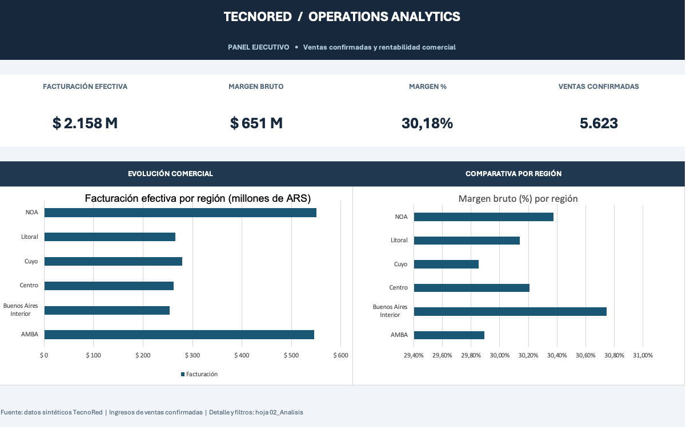
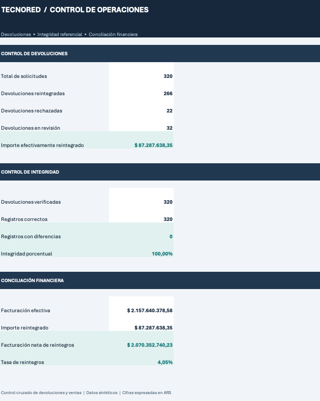
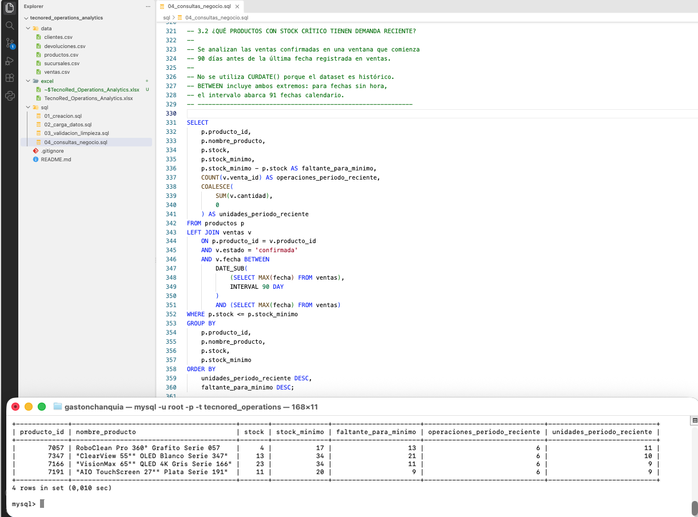
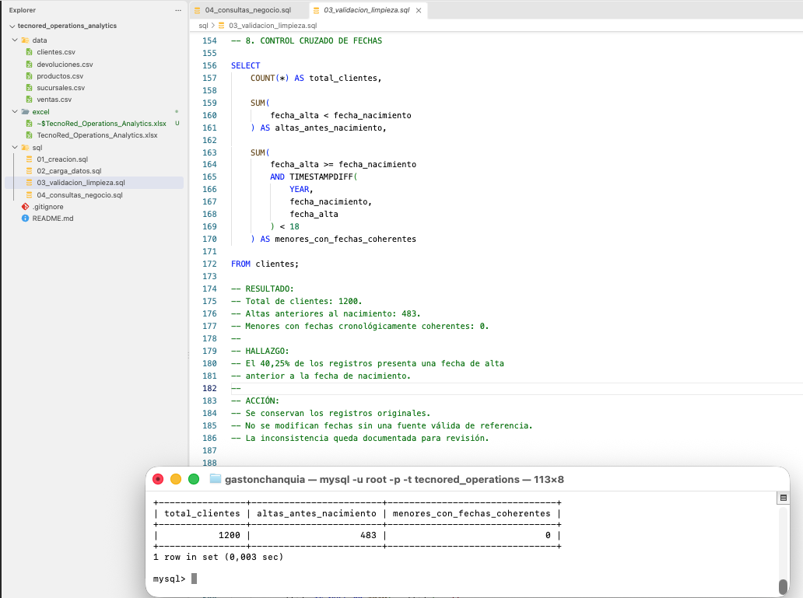

# TecnoRed | Operations Analytics

### Análisis comercial y control operativo con Excel, Power Query y MySQL

Proyecto de análisis de datos aplicado a un escenario simulado de retail tecnológico. Su objetivo es integrar información de diferentes fuentes operativas, validar su calidad y transformarla en indicadores para evaluar el desempeño comercial, el comportamiento de los clientes y el estado del inventario.

Combina preparación y visualización de datos en **Microsoft Excel y Power Query** con análisis relacional mediante **SQL en MySQL**, ejecutado desde la terminal de macOS.

> **Nota:** TecnoRed es un caso ficticio. Todos los datos son sintéticos y se utilizan con fines educativos y de portfolio.

## 1. Objetivos

- Integrar cinco fuentes de datos comerciales.
- Aplicar controles de calidad, limpieza y normalización.
- Construir indicadores de ventas, facturación y rentabilidad.
- Analizar devoluciones y comprobar la integridad de sus registros.
- Identificar patrones de compra y segmentos de clientes.
- Detectar productos con stock crítico y demanda reciente.
- Traducir los resultados técnicos en posibles acciones comerciales.

## 2. Herramientas utilizadas

| Herramienta | Aplicación |
|---|---|
| Microsoft Excel | Análisis comercial, fórmulas, indicadores y dashboard |
| Power Query | Importación, transformación y preparación de datos |
| MySQL | Gestión de la base de datos relacional |
| MySQL CLI 9.3.0 | Cliente de línea de comandos utilizado desde la terminal de macOS |
| Visual Studio Code | Escritura y organización de archivos SQL y documentación |

La versión **9.3.0** fue comprobada mediante `mysql --version` y corresponde al **cliente MySQL** instalado. La versión del servidor se puede verificar por separado mediante `SELECT VERSION();`.

En SQL se utilizaron agregaciones, `INNER JOIN`, `LEFT JOIN`, `GROUP BY`, `HAVING`, `CASE WHEN`, subconsultas, CTE y las funciones de ventana `LAG()` y `RANK()`.

## 3. Fuentes de datos

| Dataset | Registros | Descripción |
|---|---:|---|
| `clientes.csv` | 1.200 | Información de clientes |
| `productos.csv` | 120 | Catálogo, precios y stock |
| `sucursales.csv` | 8 | Información de sucursales |
| `ventas.csv` | 6.000 | Operaciones comerciales |
| `devoluciones.csv` | 320 | Solicitudes y estados de devolución |

Las fuentes se relacionan mediante identificadores para integrar la información y realizar controles de consistencia.

## 4. Estructura del repositorio

```text
tecnored_operations_analytics/
├── data/
│   ├── clientes.csv
│   ├── devoluciones.csv
│   ├── productos.csv
│   ├── sucursales.csv
│   └── ventas.csv
├── excel/
│   └── TecnoRed_Operations_Analytics.xlsx
├── sql/
│   ├── 01_creacion.sql
│   ├── 02_carga_datos.sql
│   ├── 03_validacion_limpieza.sql
│   └── 04_consultas_negocio.sql
└── README.md
```

## 5. Desarrollo del proyecto

### 5.1. Preparación y análisis en Excel

Se utilizaron Excel y Power Query para importar las fuentes, preparar los datos y construir una tabla analítica integrada. El libro `TecnoRed_Operations_Analytics.xlsx` contiene hojas de datos, análisis y control, además de un dashboard comercial.

Se desarrollaron indicadores de facturación efectiva, ventas confirmadas, margen bruto y porcentual, comparativas regionales, estados de devoluciones, integridad y conciliación entre facturación y reintegros.

### 5.2. Modelo relacional en MySQL

Se creó la base de datos `tecnored_operations`, con cinco tablas relacionadas mediante claves primarias y foráneas.

| Archivo | Contenido |
|---|---|
| `01_creacion.sql` | Creación de la base de datos y sus tablas |
| `02_carga_datos.sql` | Importación de los cinco CSV |
| `03_validacion_limpieza.sql` | Perfilado, controles de calidad y normalización |
| `04_consultas_negocio.sql` | Seis consultas principales de negocio y sentencias auxiliares |

**Ejecución:** seguir el orden numérico. Antes de ejecutar `02_carga_datos.sql`, adaptar las rutas absolutas de `LOAD DATA LOCAL INFILE` a la ubicación local de los CSV y habilitar `LOCAL INFILE` cuando corresponda. No repetir la carga sobre tablas ya pobladas sin preparar un entorno limpio.

### 5.3. Validación y limpieza de datos

Los controles permitieron detectar y documentar las siguientes situaciones:

- **483 clientes** con inconsistencia cronológica: fecha de alta anterior a la fecha de nacimiento. Se conservaron documentados por falta de información confiable para corregirlos.
- **2 nombres faltantes**, normalizados como `Sin informar`.
- **2 correos electrónicos faltantes**, conservados sin generar direcciones ficticias.
- **13 registros de ventas** con variantes de escritura en el medio de pago, normalizados para unificar categorías.
- **1 producto** con categoría y subcategoría faltantes, identificado como `Sin clasificar`.
- **320 devoluciones verificadas**, sin diferencias de integridad respecto de sus referencias comerciales.

El criterio fue corregir solo inconsistencias resolubles mediante reglas explícitas y documentar aquellas que requerían información adicional, evitando inventar datos.

## 6. Dashboard comercial

| Indicador | Resultado |
|---|---:|
| Facturación efectiva | $2.157.640.378,58 |
| Ventas confirmadas | 5.623 |
| Margen bruto | $651.178.161,41 |
| Margen bruto porcentual | 30,18 % |

El dashboard compara la facturación efectiva y el margen bruto porcentual por región. Los importes del caso simulado se expresan en pesos argentinos (ARS).

## 7. Control de devoluciones y conciliación

| Indicador | Resultado |
|---|---:|
| Devoluciones registradas | 320 |
| Devoluciones reintegradas | 266 |
| Devoluciones rechazadas | 22 |
| Devoluciones en revisión | 32 |
| Importe reintegrado | $87.287.638,35 |
| Registros verificados | 320/320 |
| Registros con diferencias | 0 |
| Integridad | 100 % |
| Facturación neta de reintegros | $2.070.352.740,23 |
| Tasa de reintegros | 4,05 % |

Este control distingue la facturación comercial del importe resultante después de los reintegros efectivamente realizados.

## 8. Consultas SQL y hallazgos comerciales

`04_consultas_negocio.sql` contiene **seis consultas principales de negocio** distribuidas en tres bloques. El archivo puede contener más sentencias `SELECT` porque algunas consultas utilizan CTE, subconsultas o comprobaciones auxiliares; estas no representan preguntas comerciales adicionales.

### Bloque 1. Evolución comercial

**1.1. ¿Cómo evoluciona la facturación mes a mes?**

Se utiliza `LAG()` para comparar cada mes con el anterior y calcular la variación porcentual. Se analizaron 32 meses, desde enero de 2024 hasta agosto de 2026.

- Mayor crecimiento mensual: abril de 2024 (**+48,14 %**).
- Mayor caída mensual: julio de 2026 (**-25,39 %**).
- Recuperación en agosto de 2026 (**+29,39 %**).

### Bloque 2. Comportamiento de clientes

**2.1. ¿Qué clientes no registraron compras confirmadas?**

Se identificaron **16 clientes** sin compras confirmadas (**1,33 %** de la base).

**2.2. ¿Cuál es la situación de esos clientes?**

De los 16 identificados, **11** no registraron operaciones, **3** presentaron una operación pendiente y **2** registraron una operación cancelada. La diferenciación permite considerar acciones comerciales según cada situación.

**2.3. ¿Qué clientes presentan mayor recurrencia de compra?**

| Segmento | Criterio |
|---|---|
| Alta recurrencia | 10 o más compras confirmadas |
| Recurrente | Entre 3 y 9 compras confirmadas |
| Baja recurrencia | 1 o 2 compras confirmadas |

Se utiliza `RANK()` para ordenar a los clientes por frecuencia de compra y se conserva la facturación individual como segunda dimensión de análisis.

**Hallazgos:** se identificaron **25 clientes de alta recurrencia**. La frecuencia máxima fue de **14 compras confirmadas**, alcanzada por dos clientes. Una mayor frecuencia no implica necesariamente una mayor facturación individual.

**Aplicación comercial posible:** identificar candidatos para campañas de fidelización, promociones exclusivas o beneficios especiales, considerando tanto recurrencia como facturación histórica. **Los umbrales utilizados son criterios propuestos para el análisis y no representan políticas comerciales reales.**

### Bloque 3. Productos y stock

**3.1. ¿Qué productos combinan ventas y stock crítico?**

Se identificaron **cuatro productos** con ventas confirmadas y stock actual igual o inferior al mínimo establecido.

**3.2. ¿Qué productos con stock crítico presentan demanda reciente?**

Se complementó el análisis histórico con ventas recientes, tomando como referencia la última fecha disponible en el dataset y no la fecha actual del sistema.

- RoboClean presenta la mayor demanda reciente y el menor stock disponible entre los productos identificados.
- ClearView requiere el mayor volumen de reposición para alcanzar su mínimo.
- El faltante conjunto de los cuatro productos hasta sus stocks mínimos es de **54 unidades**.

El stock corresponde al maestro disponible: no se reconstruyeron movimientos históricos de inventario. El resultado sirve para proponer prioridades de revisión, no para ejecutar automáticamente pedidos de reposición.

## 9. Conclusiones

El proyecto integró cinco fuentes operativas y las transformó en información útil para tres áreas de decisión:

- **Desempeño comercial:** seguimiento de ingresos, rentabilidad y diferencias regionales.
- **Clientes:** identificación de segmentos por comportamiento de compra, con posibles aplicaciones en activación y fidelización.
- **Operaciones:** control de devoluciones, conciliación financiera y detección de productos que requieren revisión de stock.

El desarrollo permitió aplicar preparación, control y análisis de datos combinando Excel, Power Query y SQL en un mismo caso de negocio.

---

**Alcance:** proyecto académico y de portfolio desarrollado con datos sintéticos. Los resultados y recomendaciones corresponden exclusivamente al escenario simulado.

## Evidencias del proyecto

### 1. Dashboard ejecutivo en Excel

Panel comercial desarrollado en Excel, con indicadores de facturación efectiva, margen bruto, rentabilidad y ventas confirmadas, acompañado de comparativos regionales.



### 2. Control operativo y conciliación financiera

Hoja de control destinada al seguimiento de devoluciones, verificación de integridad referencial y conciliación entre facturación efectiva e importes reintegrados.



### 3. Análisis SQL: productos con stock crítico

Consulta que identifica productos con existencias iguales o inferiores al mínimo establecido y contrasta su situación con la demanda registrada durante el período reciente.



### 4. Validación SQL: consistencia cronológica de clientes

Control de calidad que identifica registros con fechas de alta anteriores al nacimiento. Las inconsistencias se documentan sin modificar los datos originales cuando no existe una fuente válida de referencia.

